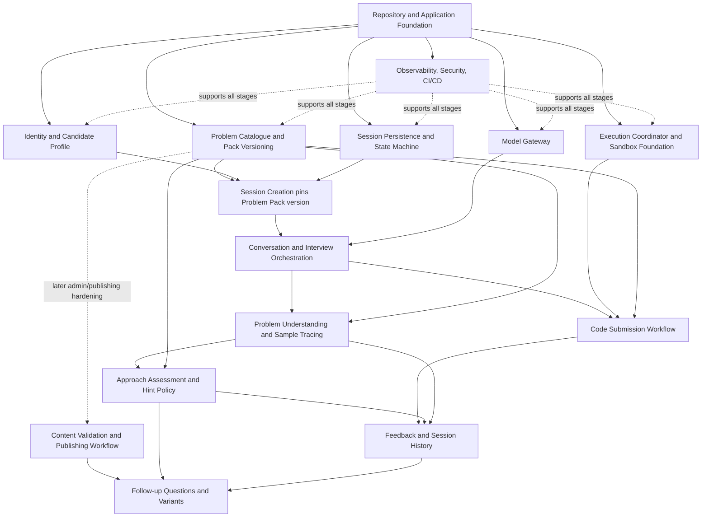

# Build Dependency Graph

**Status:** V1 planning baseline  
**Scope:** Implementation sequencing for the AI DSA Interview Practice Platform  
**Related documents:** [`01_system_master_prd.md`](../01_macro_architecture/01_system_master_prd.md), [`02_system_hld.md`](../01_macro_architecture/02_system_hld.md), [`03_data_and_domain_arch.md`](../01_macro_architecture/03_data_and_domain_arch.md), [`04_infra_and_ops_blueprint.md`](../01_macro_architecture/04_infra_and_ops_blueprint.md), [`v1_scope_and_release_plan.md`](v1_scope_and_release_plan.md), [`05_architecture_decision_records.md`](../01_macro_architecture/05_architecture_decision_records.md)

## 1. Purpose

This document translates the approved macro-architecture into a practical implementation sequence. It identifies hard dependencies, recommended sequencing, work that can happen in parallel, and the first end-to-end milestone.

The dependency graph is a planning artifact, not a requirement to finish every module before beginning integration. Prefer thin, working vertical slices over building large components in isolation.

## 2. Planning constraints and architectural guardrails

The implementation plan assumes:

- Approximately 1,000 registered/supported users as the initial product scale.
- Around 100 simultaneous active interviews and around 10 concurrent code executions as initial capacity-planning points; validate these with load tests.
- A modular monolith for application/domain logic, with separate workload boundaries for background jobs and untrusted code execution.
- PostgreSQL as the primary source of truth.
- Backend-owned interview state and policy; the LLM does not own session progression.
- Immutable, versioned Problem Pack releases pinned to each interview session.
- A snapshot plus append-only session events for efficient resume and traceability.
- A hybrid model: deterministic backend rules for control and objective checks; model-assisted interpretation for natural-language reasoning.
- Managed containers/PaaS and managed PostgreSQL before considering Kubernetes or additional infrastructure.
- Candidate code is untrusted and must never execute inside the API process or receive application secrets, hidden tests, or network access by default.

These constraints align with the current PRD, HLD, domain architecture, and infrastructure blueprint. A change to one of these foundations should be recorded in the Architecture Decision Records before downstream designs are changed.

### Local dependency satisfaction and deferred cloud evidence

ADR-022 allows local slices to continue before AWS resources are funded. K-028
has a verified local configuration/privacy/isolation portion and an outstanding
external acceptance portion (T034). Record reliance on the local portion in each
consuming feature's engineering design; K-028 stays In Progress and all other
prerequisites remain binding. This applies also to W15/K-029's K-028 dependency.
Foundation local review/commit T047/T048 depends on T033, not deferred T034.
Each provider feature retains its real-service milestone smoke/acceptance gate.
Cloud deployment and production release require T034 plus K-026 operational
evidence; see [the release schedule](v1_scope_and_release_plan.md#41-local-development-and-external-verification-schedule).

## 3. Dependency graph

The diagram is conceptual. Observability, security, testing, and CI/CD are cross-cutting work and must be introduced from the foundation onward, not postponed until the final stage.

## 4. Workstreams and dependencies

| ID | Workstream | Hard prerequisites | Main deliverables | Exit condition |
|---|---|---|---|---|
| W0 | Repository and application foundation | None | Project layout, configuration, logging, health/readiness, migrations, CI, test harness | A clean environment can start the application, apply migrations, run tests, and report health |
| W1 | Identity and candidate profile | W0 | Authenticated candidate identity and minimal profile | Requests are authenticated and authorized; profile access is isolated by user |
| W2 | Problem catalogue and Problem Pack versioning | W0 | Problem metadata, versioned pack schema, pack retrieval and validation | A reviewed test pack can be validated, published, retrieved, and pinned by version |
| W3 | Session persistence and state machine | W0; session creation also needs W1 and W2 | Session model, snapshot/event persistence, guarded transitions, resume | Invalid transitions are rejected; refresh/retry does not silently duplicate or lose transitions |
| W4 | Model Gateway | W0 | Provider abstraction, timeout and retry policy, structured-output validation, usage/cost logging | A model operation can be invoked through a single backend interface and failures are bounded |
| W5 | First interview vertical slice | W1, W2, W3; a minimal scripted interviewer may precede W4 | Open problem, start session, ask one question, accept answer, advance, resume | End-to-end path works against a seeded Problem Pack and persists session state |
| W6 | Conversation and interview orchestration | W3, W4, W2 | Stage policy, prompt context assembly, allowed actions, validated model response | Model output cannot bypass backend transition rules |
| W7 | Problem understanding and sample tracing | W2, W6 | Restatement/sample-check stages and evidence capture | Candidate responses are captured and assessed without inventing evidence |
| W8 | Approach assessment and hint policy | W2, W6, W7 | Reference-approach mapping, confidence/abstention, ordered hint ladder | Uncertain matches abstain; hints are revealed one at a time and exposure is recorded |
| W9 | Execution coordinator and sandbox | W0, security baseline, execution contract | Queue, isolated workers, compile/run/test protocol, resource limits | Adversarial tests demonstrate that code is isolated and outcomes are classified correctly |
| W10 | Code submission workflow | W2, W3, W6, W9 | Submission persistence, execution status, safe result presentation, retry handling | Submission and execution results are associated with the right session and pack version |
| W11 | Feedback and session history | W3, W7, W8, W10 | Evidence-backed feedback dimensions, version metadata, session review | Feedback links to observable evidence and separates infrastructure failures from candidate outcomes |
| W12 | Content validation and publishing | W2; validation rules evolve with W7-W11 | Draft/review/publish workflow, provenance, structural and quality checks | Only validated and reviewed immutable pack versions can be published; this hardens publishing beyond the reviewed seed-pack path |
| W13 | Follow-ups and variants | W2, W8, W11, W12 | Curated follow-up selection and variant flow | Follow-ups are selected from reviewed content and session history |
| W14 | Release hardening | All release-critical workstreams | Load, security, recovery, backup restore, monitoring, runbooks | Release gates in the PRD are demonstrated and signed off |
| W15 | Turn-based voice interaction | W1, W3, W4, W6, K-028 environment/secret baseline | Versioned consent, bounded audio input, transcription via Model Gateway, transcript display, on-demand TTS, text fallback | Voice turns use the same guarded session path as text; privacy, retention, failure, and provider controls pass tests |

## 5. Recommended implementation sequence

### Stage A — Foundation

1. Confirm repository conventions and local workflow, then establish the application skeleton and module boundaries.
2. Add configuration validation, structured logs, health/readiness endpoints, database/test-database workflow, and CI.
3. Add architecture-boundary checks where simple and valuable.
4. Establish environment separation and secret handling early (K-028).

**Do not** build a custom infrastructure platform. Use the selected managed AWS baseline (ECS/Fargate, RDS PostgreSQL, and SQS Standard); determine region, network shape, sizing, and exact security configuration during deployment design. Keep candidate execution in the separate E2B adapter boundary, subject to its production security gate.

### Stage B — Content and persisted session core

1. Define and validate the minimal Problem Pack schema.
2. Seed one reviewed problem pack for development.
3. Implement session creation with the selected pack version pinned.
4. Implement snapshot/event writes transactionally, guarded state transitions, idempotency, and resume.
5. Add authorization and tests for cross-user access.

### Stage C — First end-to-end vertical slice

Build the smallest integrated candidate journey:

1. Candidate opens a problem.
2. Candidate starts an interview session.
3. Backend creates a session pinned to a specific Problem Pack version.
4. Interviewer asks one stage-appropriate question. A deterministic stub is acceptable initially; the integration seam must match the intended Model Gateway contract.
5. Candidate submits a response.
6. Backend validates and records the response, advances only through a valid transition, and returns the next question.
7. Candidate refreshes or reopens the session and sees the persisted state.

This milestone proves the main product control path before complex assessment and execution are added.

### Stage D — Real model-driven interview

1. Add the Model Gateway and structured-output validation.
2. Add orchestration policy and stage-specific prompt context.
3. Add problem restatement, clarifications, sample tracing, and initial approach discussion.
4. Add approach matching with confidence thresholds and explicit abstention.
5. Add one-at-a-time curated hints and evidence capture.
6. Add the selected turn-based voice path (K-029): explicit consent, bounded audio upload, transcription, visible transcript, on-demand TTS, and text fallback. Treat it as a separate input/output modality, not a second state machine.
7. Test provider timeout, rate limit, malformed output, and safe recovery.

### Stage E — Code execution and feedback

1. Implement the execution coordinator and sandbox isolation as a separate trust boundary.
2. Add compilation/run outcomes, hidden-test isolation, resource limits, and bounded queues.
3. Connect submissions to the active session and pinned pack version.
4. Add code-tracing prompts for feasible failures without disclosing hidden inputs or expected outputs.
5. Generate evidence-backed feedback with distinct dimensions.

### Stage F — Content operations, variants, and release hardening

1. Complete the content review/publish workflow and provenance checks beyond the manually reviewed seed-pack path.
2. Add curated follow-ups and variants using the reviewed content workflow.
3. Run load, security, recovery, backup-restore, and cost tests.
4. Confirm the release gates in the PRD.
5. Deploy only after operational dashboards and rollback procedures are usable.

## 6. Parallel work opportunities

The following can proceed in parallel once their contracts are agreed:

- Problem Pack schema and sample content can be developed alongside application foundation work.
- Model Gateway scaffolding can be developed while session persistence is implemented, but integration must wait for the session/orchestration contract.
- Sandbox threat modeling and a small execution-isolation proof of concept should begin during M1 (K-020), alongside early session work. Full execution-coordinator and submission integration remain in M3 (K-021–K-022).
- Test fixtures, contract tests, and architecture checks should be built alongside their corresponding modules.
- Content authoring can proceed in parallel with code, but published packs must pass validation and review.

Do not parallelize work that depends on unsettled state semantics, session ownership, or data contracts. Resolve the contract first.

## 7. Critical path

The initial critical path is:

`Application Foundation -> Problem Pack Retrieval/Version Pinning + Identity/Authorization -> Session State and Persistence -> First Vertical Slice -> Model Gateway/Orchestration -> Assessment and Hints -> Code Execution -> Feedback -> Content Operations/Variants -> Release Hardening`

Turn-based voice (K-029) is a parallel V1 branch after the session API, Model Gateway, orchestration policy, and environment/secret baseline are available. It must be complete before the release is represented as voice-capable; it is not a prerequisite for code-execution mechanics.

Identity and the minimal Problem Pack can be developed in parallel with the foundation. Sandbox security work should begin early even though full execution integration comes later.

## 8. Cross-cutting acceptance requirements

Every workstream must address, where applicable:

- Authorization and tenant/user data isolation.
- Structured logs and correlation identifiers.
- Bounded timeouts, retries, and resource use.
- Idempotency for retried commands.
- Unit, integration, and contract tests.
- Metrics for latency, errors, and saturation.
- Safe failure behavior that does not score infrastructure failures as candidate failures.
- Versioning for published content and model/policy decisions.
- Documentation and operational instructions for behavior that affects production.

## 9. Definition of done for a workstream

A workstream is complete only when:

1. Its stated behavior is implemented and reviewed.
2. Relevant unit, integration, and contract tests pass in CI.
3. Authorization and failure paths are tested where applicable.
4. Logs/metrics make the main success and failure modes observable.
5. API/event/schema changes are reflected in their contracts.
6. Operational and security implications are documented.
7. Acceptance criteria in the feature requirements are satisfied.

A merged pull request alone is not sufficient evidence that a workstream is done.

## 10. Remaining implementation questions

The major V1 choices are now resolved in `docs/01_macro_architecture/05_architecture_decision_records.md`. Remaining implementation work is to select the AWS Region/network topology and resource sizing; verify E2B's production security/data-processing suitability; pin Python/C++/Java toolchains and numeric execution limits; configure operation-specific model budgets/timeouts and the Astra escalation threshold; finalize voice audio limits/consent text; validate the retention policy and provider data controls; assign actual content-review roles; and measure final capacity, SLO, RPO and RTO targets. These are gates before the affected production release, not reasons to leave provider strategy open.
