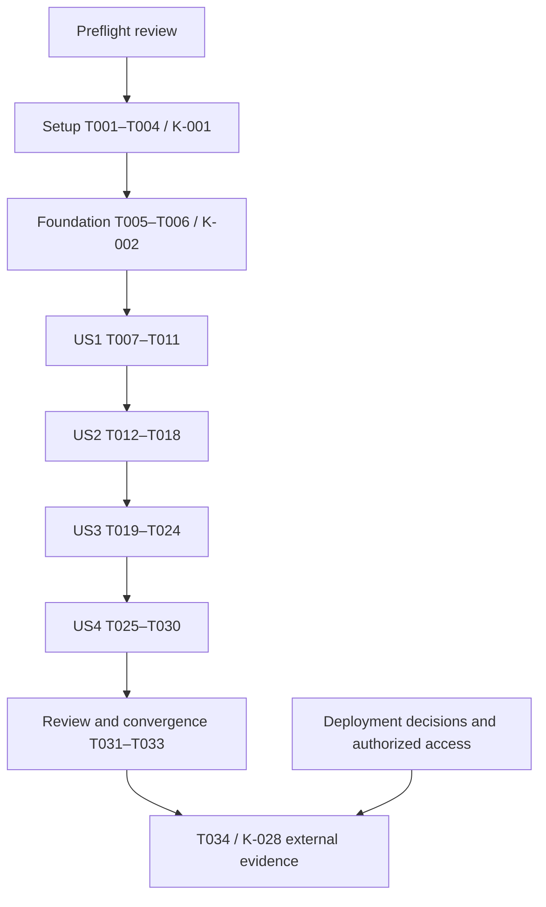

# Application Foundation — Engineering Design

**Date:** 2026-10-17  
**Task breakdown refreshed:** 2026-10-18; existing T001–T034 and Kanban mappings retained.  
**Status:** Planning complete; all implementation tasks below remain unexecuted.  
**Authority:** Canonical feature task decomposition, not an independent project tracker.  
**Inputs:** [Requirements](../../requirements/feature_req.md), [technical design](../technical/tech_design.md), [logic](../../pseudo_code/logic_and_state.md).

## Dependency readiness and task conventions

K-001 has no prerequisites. K-002 depends on K-001 even though both are under
Ready in the board. K-003/004/005/028 depend on K-002; K-006 on K-001 and K-002.
Within K-001, settings validation and a minimal test/tool harness establish its
workflow acceptance before the runtime skeleton starts. The Canonical Kanban
and CSV remain unchanged by this planning work. T IDs refine those cards; they
do not create project statuses.

Every production behavior change follows failing test → smallest implementation
→ focused passing tests → refactor. A test task must record the expected failure,
not merely add a file. Existing meaningful passing coverage may be identified
rather than manufactured into a failure. Failures require reproduction and root
cause evidence before a fix. Each task lists requirements, success criteria,
K mapping, dependencies and concrete future paths; commands follow below.
No application source/test/config/container files are created by this plan.
Code, test, tooling and runbook paths are relative to the project root;
`requirements/`, `specifications/` and `pseudo_code/` document paths are relative
to `docs/03_features/application_foundation/`.

Reviewer-owned checklist signoff is a prerequisite for starting implementation;
its items remain unchecked until the owner or designated reviewer evaluates them.
This is a preflight gate before T001, not permission deferred until T032.
The task T032 reconfirms that signoff and checks that accepted design and
implementation stayed aligned; it does not replace the preflight review.
Full K-028 evidence depends on the deployment workstream; T034 is a gated handoff,
not authorization for cloud provisioning or an alternative infrastructure plan.

## Testable vertical slices and task decomposition

### Phase 1 — Setup and K-001 workflow prerequisites

Goal: establish locked tooling, tested settings validation and documented commands.
Independent evidence: `npm ci`, `npm run config:check`, `npm run format:check`,
`npm run lint`, `npm run typecheck` and `npm run test:unit` run from the documented
clean setup; invalid configuration reports safe key names only. These are future
implementation commands, not checks executed by this task-generation run.

- [ ] T001 Record repository facts and pin compatible secure Node/npm/Next/React/TypeScript/tool versions in docs/development.md, .nvmrc, .npmrc, package.json and package-lock.json; wire minimal format/lint/type/unit commands and Vitest configuration. Validate locked installation without providers. **Map:** K-001; FR-001, FR-011; SC-001. **Depends on:** none.
- [ ] T002 Write tests/unit/config.test.ts before the parser, quoting technical-design constraints in fixtures: APP_ENV is "mandatory and exactly `development|staging|production|test`", port "1–65535", pool size "1–10", IDENTITY_ADAPTER is "`disabled|clerk|test`, default `disabled` in M0", and configuration is "immutable after startup". Test finite positive budgets, missing runtime DATABASE_URL, build without secrets, missing unused-provider keys, test identity rejected in staging/production and rejection of unimplemented Clerk mode without fallback. Observe expected failing cases with npm run test:unit. **Map:** K-001; FR-003, FR-004, FR-012; SC-002. **Depends on:** T001.
- [ ] T003 Implement src/server/config.ts and config/development.example.json, config/staging.example.json, config/production.example.json using safe non-secret names/references; never embed credential-bearing URLs, export NEXT_PUBLIC secrets or log raw validation errors. Run config tests green and refactor. **Map:** K-001, K-028; FR-003, FR-004, FR-006; SC-002. **Depends on:** T002.
- [ ] T004 Complete docs/development.md and package.json workflow command discovery; validate config, format/lint/type and initial unit commands from a clean environment. K-001 must meet its acceptance before K-002 work; unavailable clean-checkout evidence is reported, never inferred from this plan. **Map:** K-001; FR-001, FR-015; SC-001. **Depends on:** T003.

### Phase 2 — Foundational application composition

Goal: make the validated application runnable before story-specific extensions.
Independent evidence: lifecycle and minimal liveness tests pass; failed validation
opens no listener, and bounded shutdown closes acquired resources.

T005/T006 establish the first real App Router route before Next preparation and
US1 startup/registry tests. This minimal liveness path makes K-002 runnable; it
does not complete K-004 or remove its K-002 dependency. US2 extends the same
health module with readiness and full compatibility evidence.

- [ ] T005 Write tests/unit/lifecycle.test.ts with an injected HTTP/Next adapter: config failure opens no listener, initialization failure cleans resources, startup has a finite deadline, drain prevents readiness and repeated stop is safe. Add tests/unit/health-live.test.ts for the initial canonical GET /api/v1/health/live Node Route Handler: unauthenticated 200/ok, UTC timestamp, no-store, runtime-registry access and no dependency calls. Observe failures before bootstrap/liveness implementation. **Map:** K-002; FR-002, FR-003, FR-007, FR-012, FR-013, FR-014; SC-001, SC-002, SC-003. **Depends on:** T004.
- [ ] T006 Implement src/server/bootstrap.ts, src/server/runtime.ts, scripts/build-server.mjs, scripts/build-migration-manifest.ts and next.config.ts; add src/server/health.ts with the dependency-free liveness function and src/app/api/v1/health/live/route.ts as the first real uncached Node Route Handler before Next preparation/build. Compile the custom Node server with external framework packages, explicitly invoke config before listen, install the shared process registry, lazy resource factories and bounded signal cleanup. Keep route imports/build secret-free and standalone output disabled; run lifecycle and health-live tests green. Full readiness and K-004 acceptance remain T014–T024. **Map:** K-002; FR-002, FR-003, FR-007, FR-013, FR-014; SC-001, SC-003. **Depends on:** T005.

### Phase 3 — US1: reproducible and bounded service

Priority: P1. Goal: a developer can start and change the service reproducibly.
Prerequisite: Phases 1–2 and their acceptance evidence.

Independent proof: production build starts with validated settings, rejects unsafe configuration, and rejects forbidden imports. MVP scope is the reproducible operational skeleton; candidate experience is deferred.

- [ ] T007 [US1] Write tests/architecture/boundaries.test.ts, tests/architecture/client-imports.test.ts and tests/architecture/fixtures/ for forbidden private repository imports, domain-to-provider calls, client-to-server leaks and API/domain candidate-code execution primitives; first observe fixtures rejected/allowlisted cases accepted. **Map:** K-002; FR-002, FR-012, FR-014; SC-006. **Depends on:** T006.
- [ ] T008 [US1] Implement .dependency-cruiser.cjs and src/modules/README.md ownership/public.ts rules aligned with HLD; map all domain boundaries without generating business logic or product endpoints. Run npm run test:architecture including negative fixtures, then refactor. **Map:** K-002; FR-002, FR-014; SC-006. **Depends on:** T007.
- [ ] T009 [US1] Write tests/process/startup.test.ts and tests/helpers/process.ts for production-build start, invalid config with no bound port, no provider/DB build credentials, actual Next liveness route access to the bootstrapped runtime registry, HMR resource reuse and secret-free stdout/stderr. Record expected missing-behavior failures before strengthening runtime wiring. **Map:** K-002, K-028; FR-003, FR-004, FR-012, FR-013; SC-001, SC-002. **Depends on:** T008.
- [ ] T010 [US1] Complete src/server/bootstrap.ts and src/server/runtime.ts against observed production-build failures, using a process-global Symbol registry and bounded startup/drain. Run npm run build and startup process tests; prove no import-time DB/provider work or duplicate pool/listeners rather than assuming bundle module identity. **Map:** K-002, K-028; FR-002, FR-003, FR-013; SC-001, SC-002. **Depends on:** T009.
- [ ] T011 [US1] Document environment/resource/credential separation, TLS verification, Secrets Manager injection references, runtime versus execution task-role ownership, rotation/restart and redacted evidence requirements in docs/runbooks/foundation.md; extend tests/unit/config.test.ts for TLS and adapter guard failures. Implement only tested local guards; leave actual cloud evidence to T034. **Map:** K-028; FR-004, FR-006, FR-015; SC-002, SC-007. **Depends on:** T010.

### Phase 4 — US2: observable health and safe failures

Priority: P1. Goal: an operator can distinguish liveness from readiness and trace
failures without exposing candidate or secret data. Requires the shared runtime
from US1; full real-storage readiness evidence follows US3.

Independent proof: injected healthy/failing dependencies produce canonical health output, and concurrent telemetry canaries stay private. Actual-storage readiness acceptance is integrated after US3.

- [ ] T012 [US2] Write tests/unit/request-context.test.ts, tests/unit/logger.test.ts and tests/unit/http.test.ts for the RequestContext constraints "Server UUID `requestId`, monotonic start" and "Async request scope, always cleared": fresh server IDs, ignored malicious input IDs, concurrent isolation, context reset after throw/cancel, unmatched-route constant and absence of planted tokens/body/query/error secrets. Observe failures before telemetry code. **Map:** K-003; FR-005, FR-006, FR-012; SC-004. **Depends on:** T010.
- [ ] T013 [US2] Implement src/server/request-context.ts, src/server/logger.ts and src/server/http.ts with AsyncLocalStorage via runtime registry, Pino allowlisted bounded events, no request serializer/raw URL/error text, and context cleanup in finally. Wire bootstrap completion handling without reading bodies; run focused tests green. **Map:** K-003; FR-005, FR-006; SC-004. **Depends on:** T012.
- [ ] T014 [US2] Extend coverage in tests/unit/health.test.ts and tests/contract/health.test.ts against root contracts/api/v1_openapi.yaml: retain tests/unit/health-live.test.ts regressions; quote HealthStatus constraints `required: [status, timestamp]`, `enum: [ok, degraded, unavailable]`, timestamp `format: date-time`, and optional checks values `enum: [ok, degraded, unavailable, skipped]`. Verify effective /api/v1 paths, no auth, no-store cache policy, mandatory failure, optional outage, exact ordered schema mismatch and timeout; foundation emits only its documented ok/unavailable outcomes. Observe newly missing readiness/orchestration cases fail before implementation; do not recreate the already passing liveness slice. **Map:** K-004; FR-007, FR-008, FR-012, FR-014; SC-003. **Depends on:** T013.
- [ ] T015 [US2] Extend src/server/health.ts with readiness orchestration and add src/app/api/v1/health/ready/route.ts as an uncached Node runtime adapter; preserve the existing src/app/api/v1/health/live/route.ts introduced in T006. Liveness still performs no dependency access; readiness uses initialization/drain plus an injected bounded DB/schema adapter and only safe named checks. Run existing liveness and new unit/contract cases green. **Map:** K-004; FR-007, FR-008, FR-014; SC-003. **Depends on:** T014.
- [ ] T016 [US2] Write failing pool/deadline cases in tests/integration/database.test.ts (using an explicitly guarded dedicated test DB for this slice), then implement src/server/database.ts and src/server/schema-version.ts: lazy pool, 500 ms connect/acquire and statement bounds, 2000 ms overall readiness deadline, exact manifest/ledger comparison, query cancellation or destroyed client and finally release. Readiness remains unavailable until US3 baseline exists. **Map:** K-004, K-005; FR-008, FR-009, FR-013; SC-003. **Depends on:** T015.
- [ ] T017 [US2] Add tests/process/privacy.test.ts capturing both stdout/stderr from the production build with parallel requests, query/header/body canaries, raw dependency exceptions, cancellations and absent provider credentials; demonstrate leak/control failures if present before corrections. Use tests/helpers/process.ts synthetic fault fixtures, never new production test endpoints. **Map:** K-003, K-004; FR-005, FR-006, FR-012; SC-004. **Depends on:** T016.
- [ ] T018 [US2] Apply evidence-based telemetry/error fixes in src/server/http.ts, src/server/logger.ts, src/server/database.ts and next.config.ts; suppress framework URL/payload diagnostics and handle idle pool errors safely. Run focused unit/contract/privacy checks green; report any framework leakage as a blocker. **Map:** K-003, K-004; FR-005, FR-006, FR-007; SC-003, SC-004. **Depends on:** T017.

### Phase 5 — US3: explicit migrations and isolated storage

Priority: P1. Goal: evolve storage repeatably without touching another environment.
Requires US2's database/schema adapter. Migration commands and fixture cleanup
remain explicit tooling, never startup or probe side effects.

Independent proof: empty/repeated/failed/concurrent migration and two concurrent test runs succeed or fail safely against real PostgreSQL without touching non-test resources.

- [ ] T019 [US3] Write tests/integration/test-isolation.test.ts for APP_ENV=test, approved host/port and exact allocated ownership; quote database-name constraints "`foundation_test_`" and "Names are at most 63 bytes and contain only lowercase letters, digits and underscores" from technical design. Cover cleanup refusal, allocation failure and concurrent run/worker independence. Observe unsafe-path rejection failures before fixture implementation. **Map:** K-005; FR-010, FR-012; SC-005. **Depends on:** T018.
- [ ] T020 [US3] Implement tests/helpers/test-database.ts and scripts/test-database.ts with dedicated test-admin configuration, unique owned databases, safe identifier quoting, no credential-bearing output and 30 s setup/teardown deadlines; reject all non-test targets and reuse these fixtures in database tests. Run isolation cases green. **Map:** K-005; FR-010; SC-005. **Depends on:** T019.
- [ ] T021 [US3] Write tests/integration/migrations.test.ts with real PostgreSQL: empty apply, repeated no-op, transactional failure, immutable ordered history, fail-fast concurrent migration, timeout lock release and recovery; test-only failing revisions stay in temporary fixture directories. Observe failures before the migration runner/baseline. **Map:** K-005; FR-009, FR-010, FR-012; SC-005. **Depends on:** T020.
- [ ] T022 [US3] Implement scripts/migrate.ts and migrations/1781654400000_foundation.sql with legacy Up/Down Migration sections and no domain tables; use stable verified node-pg-migrate, explicit singleTransaction/checkOrder, lock enabled, dedicated MIGRATION_DATABASE_URL, safe logging, 2 s connect/30 s statement/60 s command limits and actual client/process termination on timeout. Build expected revision manifest; run migration tests green. **Map:** K-005; FR-009; SC-005. **Depends on:** T021.
- [ ] T023 [US3] Complete tests/integration/readiness.test.ts for no ledger, missing/older/newer/unknown history, pool exhaustion/real query timeout, restored DB and optional provider outages using isolated fixtures; run existing pure health tests alongside real-driver tests. Identify any difference from the promised status/deadline behavior. **Map:** K-004, K-005; FR-007, FR-008, FR-009, FR-010; SC-003, SC-005. **Depends on:** T022.
- [ ] T024 [US3] Resolve only observed driver/schema/migration integration failures in src/server/database.ts, src/server/schema-version.ts and scripts/migrate.ts, then run all storage/probe/isolation cases concurrently and refactor. Verify no leaked active queries, locks, connections or foreign databases altered. **Map:** K-004, K-005; FR-008, FR-009, FR-010, FR-013; SC-003, SC-005. **Depends on:** T023.

### Phase 6 — US4: regression gates and executable smoke journey

Priority: P1. Goal: reject regressions with observed automated evidence.
Requires US1–US3 so process/container checks exercise the actual integrated service.

Independent proof: required pipeline stages run, planted regressions fail, a built process/container completes the health/outage/shutdown journey, and unavailable stages are reported honestly.

- [ ] T025 [US4] Write tests/ci/negative-controls.test.ts for required commands and nonzero stage propagation; define deliberate unit/lint/boundary failures in isolated temporary copies. Observe missing command/fail-open failures before the CI pipeline implementation. **Map:** K-006; FR-011, FR-012; SC-006. **Depends on:** T024.
- [ ] T026 [US4] Implement .github/workflows/ci.yml and package.json scripts for npm ci, format/lint/type, unit, real-DB integration, canonical contract, architecture, build, process tests, npm audit and Gitleaks. Pin workflow actions by reviewed commit and scanners by version/digest, use nonproduction DB service, no paid-provider secrets; scanners/network/service failures must fail required stages. **Map:** K-006; FR-011; SC-006. **Depends on:** T025.
- [ ] T027 [US4] Add Dockerfile, .dockerignore and compose.yaml for ordinary Next output/custom entrypoint, non-root runtime, correct exec-form signal delivery and separate local PostgreSQL. Include production dependencies, compiled bootstrap and revision manifest; exclude .env/credentials/docs notes. Build without runtime secrets; add pinned Trivy image and filesystem scanning stages, inspect image layers/config for canaries. **Map:** K-002, K-006; FR-001, FR-004, FR-011; SC-001, SC-006. **Depends on:** T026.
- [ ] T028 [US4] Implement tests/process/foundation.test.ts and tests/process/shutdown.test.ts plus scripts/verify-foundation.ts: clean install/build/migrate/start, uncached live/ready, DB outage/recovery, no-auth health, SIGTERM readiness/drain/closed resources, forced-deadline failure, cleanup. Use real process/socket observations; capture expected red tests before any needed runtime corrections. **Map:** K-004, K-006; FR-007, FR-008, FR-012, FR-013; SC-001, SC-003. **Depends on:** T027.
- [ ] T029 [US4] Fix only reproduced process/build/container integration failures in src/server/bootstrap.ts, src/server/runtime.ts, src/server/http.ts and Dockerfile; run production process and container smoke checks green, then refactor. Keep cloud deployment and candidate UI out of this slice. **Map:** K-002, K-004, K-006; FR-003, FR-006, FR-008, FR-013; SC-001, SC-002, SC-003, SC-004. **Depends on:** T028.
- [ ] T030 [US4] Implement scripts/verify-ci-negative-controls.ts; run npm run verify:ci-failures in disposable work copies and prove deliberate unit/lint/boundary mutations each cause nonzero pipeline-stage outcome. Remove only owned temporary fixtures; do not corrupt the real source or report local simulation as a hosted CI run. **Map:** K-006; FR-011, FR-012; SC-006. **Depends on:** T029.

### Phase 7 — Review, reconciliation and operational handoff

Goal: reconcile observed results and review feedback before completion claims.
Independent evidence: important-change review and convergence are recorded,
each completed Kanban card has its own passing evidence, and external deployment
gates remain open until verified. T034 is an externally gated handoff.

- [ ] T031 Finalize docs/development.md and docs/runbooks/foundation.md with exact implemented commands, sanitized evidence, migration fail/forward-fix/approved-restore procedure, build/start/stop and required secret-role references. Preserve explicit unexecuted/cloud gates; do not claim backup/restore or K-028 complete from local tests. **Map:** K-001, K-005, K-028; FR-001, FR-004, FR-009, FR-015; SC-001, SC-007. **Depends on:** T030.
- [ ] T032 Reconfirm the owner/designated reviewer pre-implementation signoff on requirements/feature_req.md CHK001–CHK024; obtain important-change code review against specifications/technical/tech_design.md, specifications/engineering/eng_design.md and pseudo_code/logic_and_state.md. Renew requirements review for material accepted changes; never treat this late review as a substitute for the pre-T001 gate. Discover available review skills before use; assess feedback technically and reconcile accepted changes before claiming acceptance. **Map:** K-001, K-002, K-003, K-004, K-005, K-006, K-028; FR-002, FR-006, FR-014, FR-015; SC-007. **Depends on:** T031.
- [ ] T033 Execute required commands and capture exact observed results in docs/runbooks/foundation.md; run $speckit-converge and reconcile real gaps with this engineering design. Update project_management/kanban_board.md and project_management/kanban_tasks.csv only for cards whose own acceptance actually passes; leave incomplete environment evidence open. **Map:** K-001, K-002, K-003, K-004, K-005, K-006, K-028; FR-011, FR-012, FR-015; SC-001, SC-002, SC-003, SC-004, SC-005, SC-006, SC-007. **Depends on:** T032.
- [ ] T034 Collect redacted staging/production resource separation, Secrets Manager injection/rotation and least-privilege task-role evidence into docs/runbooks/foundation.md when the deployment workstream is ready. Read-only verify supplied resource references; do not provision infrastructure from this foundation task. Record unresolved gates in the existing K-028 card/CSV; it cannot become Done before evidence passes. **Map:** K-028; FR-004, FR-015; SC-007. **Depends on:** T033 plus deployment-team environment/region/network decisions and authorized existing-resource access.

## Dependency graph, parallel opportunities and delivery strategy

| Task group | IDs | Count | Independent acceptance focus |
|---|---|---|---|
| Shared setup/foundation | T001–T006 | 6 | Locked tooling, validated settings, bounded runnable process and minimal liveness |
| US1 (P1) | T007–T011 | 5 | Production-build start, configuration rejection, module-boundary failures and local environment guards |
| US2 (P1) | T012–T018 | 7 | Canonical live/ready outcomes, concurrent request isolation and no telemetry canary leakage; real-storage readiness awaits US3 |
| US3 (P1) | T019–T024 | 6 | Real PostgreSQL migration repeatability/failure/locking, exact schema compatibility and owned concurrent test databases |
| US4 (P1) | T025–T030 | 6 | All required stages execute, planted regressions fail, built process/container health and shutdown journey passes |
| Review/handoff | T031–T034 | 4 | Observed evidence, code review, convergence and externally gated environment verification |
| Total | T001–T034 | 34 | Task generation does not establish implementation completion |

The delivery sequence is deliberately serial for a solo developer. Phase 1
makes K-001 verifiable before K-002. US1 precedes US2; US2 can prove behavior
with fakes before US3 supplies the real migration path; US4 then integrates the
production process/container. T034 additionally waits for external deployment
inputs. T012's hard prerequisite is T010; completing T011 first is the recommended
story-completion order, not an additional runtime dependency. No whole task is
marked `[P]`: task execution follows one active task at a time, and shared runtime
changes and test-first acceptance pairs remain sequential.

This diagram is the recommended story order; each task's `Depends on` field
defines its hard task dependencies. All stories are P1, so dependencies determine
their order. US2 has unit/contract evidence before US3; full real-storage health
acceptance requires US3. Reaching US1 alone is an operational MVP, not M0 completion.

After prerequisites stabilize, independent test authorship can be split without
claiming production tasks are independent: US1 boundary fixtures and startup
fixtures, US2 telemetry cases and health-schema cases, US3 migration fixtures and
unsafe-cleanup fixtures, US4 scanner configuration and disposable negative-control
fixtures. Each pair targets separate test/config paths; run integration and
shared-source mutations sequentially. These are optional examples, not agent
spawning or concurrent implementation authorization.

| Story | Possible separate-file work after the relevant prerequisites | Coordination limit |
|---|---|---|
| US1 | `tests/architecture/boundaries.test.ts` fixtures and `tests/process/startup.test.ts` fixtures after T006 | Execute T007–T010 acceptance in order; both depend on runtime wiring |
| US2 | `tests/unit/logger.test.ts` canaries and `tests/contract/health.test.ts` schema fixtures after T010 | Keep logger/bootstrap changes and T012–T018 red/green evidence sequential |
| US3 | `tests/integration/migrations.test.ts` fixtures and `tests/integration/test-isolation.test.ts` unsafe-target fixtures after T018 | Real database tests require guarded allocations; migration verification waits for T022 |
| US4 | Scanner settings in `.github/workflows/ci.yml` and disposable fixtures for `scripts/verify-ci-negative-controls.ts` after T024 | Aggregate acceptance waits for actual commands/container; shared workflow edits are coordinated |

These are planning examples of separable fixture preparation, not `[P]` execution
tasks, sub-agent instructions or claims that an incomplete predecessor can be skipped.

Deliver the smallest developer/operator slice first: configuration validation,
custom server lifecycle, minimal canonical liveness route and empty modular
boundaries (US1). Extend health with readiness and safe logging (US2), then real migration/test-storage workflow (US3), then CI and executable
smoke evidence (US4). No product route is claimed by the skeleton. Future feature
implementation begins only after its documented hard prerequisites pass.

## Planned commands and validation journey

**These commands are implementation deliverables.** There is no package.json or
application to run them against today. K-001/K-006 must implement the scripts and
the guide with the following names; `npm run` discovers them. Follow commands
from the project root, with the pinned Node/npm versions, container runtime,
explicit safe development settings and dedicated PostgreSQL test service.
Never paste credentials into commands, docs or evidence.

| Command | Required behavior/evidence |
|---|---|
| `npm ci` | Locked dependency installation; reject package/lock drift |
| `npm run config:check` | Validate runtime settings without values in output; no listening socket or DB query |
| `npm run format:check` | Prettier check, nonzero on formatting drift |
| `npm run lint` | ESLint directly; Next build is not a substitute |
| `npm run typecheck` | Strict TypeScript check |
| `npm run test:unit` | Config, lifecycle, HTTP, health, logger and concurrent context fixtures |
| `npm run test:architecture` | Dependency rules and negative fixtures, client/server secret boundary |
| `npm run db:migrate` | Dedicated explicit migration runner, locking and deadlines, real PostgreSQL |
| `npm run test:integration` | Guarded test DB allocation, pool/query failure, migration, isolation and real readiness |
| `npm run test:contract` | Health producer responses against root OpenAPI paths/schema/enums/auth exceptions |
| `npm run build` | Manifest generation + `next build` + custom entrypoint compilation; no DB/provider runtime credentials required |
| `npm run dev` | Custom server in development mode, bounded startup and no duplicate HMR resources |
| `npm start` | Built custom server, NODE_ENV=production, runtime APP_ENV settings, no automatic migrations |
| `npm run test:process` | Production subprocess startup, privacy, registry sharing, signal/drain and health journey |
| `npm run verify:foundation` | Orchestrate local install/build/migrate/start/probe/outage/recovery/stop with owned cleanup |
| `npm run verify:ci-failures` | Isolated deliberate test/lint/boundary failures each detected with nonzero stage exit |
| `npm audit --audit-level=high` | Required dependency security gate; scanner/service unavailability fails stage |
| `npm run scan:secrets` | Pinned Gitleaks filesystem scan; works without Git metadata; no values printed in evidence |
| `npm run container:build` | Ordinary Next/custom-server image, non-root, no secret-bearing build args or layers |
| `npm run scan:image` | Pinned Trivy image scan; HIGH/CRITICAL fail; database/download failure is unavailable, never pass |
| `npm run scan:filesystem` | Pinned Trivy filesystem scan for applicable dependency/config issues with the same reporting rule |
| `npm run verify:ci` | Aggregate all required stages including integration, process, container and security checks; never use continue-on-error to claim acceptance |

Clean-environment journey: provision only local/test storage via documented
`docker compose up -d db`, install locked dependencies, configure development
settings through the local untracked mechanism, run config checks, explicitly
migrate, build, start and query `/api/v1/health/live` and `/api/v1/health/ready`.
Expect 200/ok with no authentication. Stop the DB: live remains 200; ready becomes
503 within 2000 ms and reveals only safe checks. Restart DB: readiness recovers.
Repeat probes across schema changes and time to ensure responses are not cached.
Run required verification, then send SIGTERM: no new admission, draining state
observed internally, admitted work bounded, no leaked process/pool and successful
normal exit. A deliberately stalled drain must terminate nonzero within 30 s.
The process harness owns children/ports and tears them down in finally. Container
smoke exercises the same entrypoint and signal delivery.

## Evidence matrix

| Requirement | Task evidence | Acceptance |
|---|---|---|
| FR-001 | T001, T004, T027–T031 | SC-001; clean workflow with exact commands |
| FR-002 | T005–T010, T032 | US1; no forbidden fixture imports |
| FR-003 | T002, T003, T005, T006, T009, T010 | SC-002; rejected unsafe config before listener |
| FR-004 | T003, T011, T027, T031, T034 | Local separation guards plus explicit external K-028 evidence |
| FR-005 | T012, T013, T017, T018 | SC-004; request separation and bounded correlation |
| FR-006 | T003, T011–T013, T017, T018, T029, T032 | SC-004; zero planted sensitive values in stdout/stderr/artifacts |
| FR-007 | T005, T006, T014, T015, T018, T023, T028 | SC-003; canonical probe schema/paths/no auth/no cache |
| FR-008 | T014–T016, T023, T024, T028, T029 | SC-003; mandatory outage/schema/deadline and recovery |
| FR-009 | T016, T021–T024, T031 | SC-005; locked transactional migration and safe recovery |
| FR-010 | T019–T021, T023, T024 | SC-005; concurrent owned test DBs and unsafe cleanup refusal |
| FR-011 | T001, T025–T027, T030, T033 | SC-006; all required checks + negative controls |
| FR-012 | T002, T005, T007, T009, T012, T014, T017, T019, T021, T025, T028, T030, T033 | Red/green evidence, real integration and process checks |
| FR-013 | T005, T006, T009, T010, T016, T024, T028, T029 | SC-003; bounded startup/query/drain and actual cleanup |
| FR-014 | T005–T008, T014, T015, T032 | Root-contract compatibility; policy boundaries retained |
| FR-015 | T004, T011, T031–T034 | SC-007; review/convergence/true Kanban acceptance |

All seven success criteria have work mapping: SC-001 workflow/process;
SC-002 configuration; SC-003 health/lifecycle; SC-004 privacy/context;
SC-005 storage isolation; SC-006 CI controls; SC-007 review/status/evidence.
No business KPI or provisional production SLO is claimed by this mapping.

## Migrations, recovery and rollout

M0 baseline creates only migration metadata and its no-domain baseline record.
Explicit apply is repeatable. Transactional failure rolls back the failing work;
readiness stays unavailable for a missing/incompatible ledger. Inspect sanitized
state, correct with a reviewed forward migration and reapply. Never edit applied
history, stamp a failed migration as complete, automatically run down in production
or restore without approved target/data-loss decisions. Future nontransactional
DDL requires a documented compensating/recovery plan in its owning feature.

Roll out locally and in CI first. The ordinary image must be able to build without
runtime secrets; secrets enter only the runtime process. Verify startup, health,
DB failure/recovery and shutdown. Actual AWS account/region/network/provisioning,
CI hosting credentials, RDS sizing, external provider access and deployment are
outside this documentation authorization. K-028 handoff evidence includes separate
resource/secret references, least privilege and rotation with sensitive values
removed. K-026 owns measured production restore/rollback/load/alerting evidence.

## Review and completion gates

Before implementation: owner/designated reviewer evaluates the canonical CHK
checklist and four documents; resolve material changes in the existing ADR/contract
sources. The built-in spec-quality check is 16/16; that is writing quality only.
Superpowers was not discoverable during setup/current session, so do not claim it
was invoked. Recheck discovery before coding. When actual PostgreSQL implementation
begins, install the specialist project-locally per current repository instructions;
AWS specialist installation waits for actual AWS work. Neither installation is
needed for this documentation-only plan.

During implementation record failing-test and passing-test evidence, unavailable
commands and focused debugging conclusions. Important code changes need review.
After required checks pass, run `$speckit-converge`, reconcile gaps and accepted
design changes into all affected canonical documents/contracts/ADRs. Only observed
card acceptance can change Kanban/CSV; T033 cannot mark K-028 complete without
T034's external evidence. No memory note or task checkbox proves completion.

This planning session ran document/Spec Kit consistency checks only. Application
unit/integration/contract/process tests, package install/build, scanners, container
smoke, hosted CI, deployment and cloud evidence were not run.

## Planning validation evidence — 2026-10-17

The owner approved remediation of analysis finding I1. T005 now specifies the
initial failing liveness test and T006 introduces the real App Router liveness
route before US1 startup/registry checks. T014/T015 extend that implementation
with broader health/readiness coverage. Task IDs, requirement count and scope
are preserved. A focused inline `python3` check of this ordering and its
requirements/technical/pseudocode reconciliation passed before re-analysis.

Executed from the project root during documentation preparation:

- `SPECIFY_FEATURE_DIRECTORY=.specify/work/application_foundation .specify/scripts/bash/check-prerequisites.sh --json --paths-only`: passed; active working paths resolved and pointer verified. The returned feature-context name is not proof of a Git branch.
- `SPECIFY_FEATURE_DIRECTORY=.specify/work/application_foundation .specify/scripts/bash/setup-plan.sh --json`: passed; project plan override loaded.
- `SPECIFY_FEATURE_DIRECTORY=.specify/work/application_foundation .specify/scripts/bash/check-prerequisites.sh --json --template checklist-template`: passed; project checklist override returned.
- `SPECIFY_FEATURE_DIRECTORY=.specify/work/application_foundation .specify/scripts/bash/setup-tasks.sh --json`: passed; project tasks override and supporting artifact paths returned.
- `python3 /tmp/check-foundation-docs.py`: passed after correcting the temporary checker's filename matcher to include `.yaml`; four canonical documents, four stories, 15 FRs, seven SCs, 24 unchecked custom criteria and 34 tasks; all 22 criteria mapped, no unmapped tasks, ordered dependency references, links and mirror equality checked. The temporary checker is session validation material, not an application test or a second project tracker.
- An inline `python3` check using duplicate-key-detecting PyYAML and `jsonschema.Draft202012Validator.check_schema`: passed; existing health path/auth/schema structure and event schema checked. No runtime producer compatibility is claimed.
- `SPECIFY_FEATURE_DIRECTORY=.specify/work/application_foundation specify integration status`: **OK**, zero modified/missing managed files, invalid paths or unchecked manifests.
- SHA-256 comparison against the session snapshot: canonical API/events and Kanban/CSV remain unchanged. No permanent `specs/` tree exists.

Git status/diff was unavailable during the 2026-10-17 planning checks because
usable Git metadata was absent. The owner authorized local repository initialization
on 2026-10-18; see the setup audit. The earlier planning results do not establish
a commit, push or hosted CI run.
The final `$speckit-analyze` is read-only; its findings are reported in the session
after the artifacts and mirrors are finalized, rather than written as a second
accepted analysis/status document.

## Task regeneration evidence — 2026-10-18

The owner invoked `$speckit-tasks` for Application Foundation. The explicit
working path and persisted feature pointer both resolve to
`.specify/work/application_foundation`; setup loaded the project tasks-template
override. The four canonical feature documents, working spec/plan and supporting
references were reviewed. Existing task IDs and Kanban mappings were retained.
Story goals, independent evidence, field constraints, delivery/parallel examples
and the preflight-versus-final-review distinction were made explicit above.

Executed documentation/tool checks:

- `SPECIFY_FEATURE_DIRECTORY=.specify/work/application_foundation .specify/scripts/bash/setup-tasks.sh --json`: passed; returned the absolute feature/template paths, project template content and four supporting artifact entries.
- `SPECIFY_FEATURE_DIRECTORY=.specify/work/application_foundation .specify/scripts/bash/check-prerequisites.sh --json --require-tasks --include-tasks`: passed; resolved the intended feature and existing task artifact.
- `python3 /tmp/check-foundation-docs.py`: passed; 34 sequential unique tasks, ordered dependency references, all 15 requirements and seven success criteria mapped, valid links and canonical/working mirror equality. This is a temporary document checker, not an application test.
- `SPECIFY_FEATURE_DIRECTORY=.specify/work/application_foundation specify integration status`: OK; zero modified/missing managed files, invalid paths or unchecked manifests.

The regenerated `tasks.md` remains an ignored, non-authoritative mirror of this
document. Reviewer-owned CHK001–CHK024 remain unchecked. No application tests,
build, dependency installation, CI run or implementation were performed by this
task-generation step. Re-run `$speckit-analyze` on the refreshed artifacts before
implementation review; an earlier analysis does not certify these edits.
